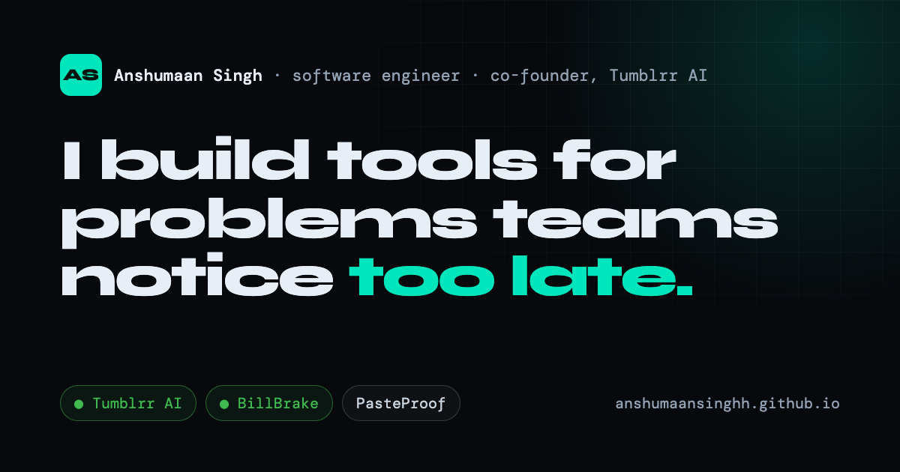

# anshumaansinghh.github.io

The personal site of Anshumaan Singh: software engineer and co-founder of [Tumblrr AI](https://www.tumblrr.tech/).

**Live:** https://anshumaansinghh.github.io/



## What's here

| File | What it is |
|---|---|
| `index.html` | The whole site in one file: HTML, CSS and a little JavaScript. No framework and no build step. |
| `assets/img/` | Product screenshots (WebP) and the GPTCOIN logo |
| `assets/og.png` | The 1200×630 preview image that LinkedIn, X and WhatsApp show when the link is shared |
| `assets/og-source.html` | The source for `og.png` |
| `assets/apple-touch-icon.png`, `favicon.svg` | Icons |
| `404.html` | The page GitHub Pages shows for a broken link |
| `robots.txt`, `sitemap.xml` | For search engines |
| `.nojekyll` | Tells GitHub Pages to serve the files as they are, without running Jekyll |

## Features

- Dark and light themes. The site follows the visitor's system setting until they pick one with the toggle.
- Works on phones: a menu button at narrow widths, and no sideways scrolling from 360 px up.
- Accessible: a skip link, visible keyboard focus, labelled icon buttons, and alt text on images. Animations switch off when the visitor asks for reduced motion.
- Search and sharing: description, canonical URL, Open Graph and X card tags, and `Person` structured data.
- Fast: about 120 KB of images, all lazy-loaded; the only external requests are Google Fonts.

## Editing

Open `index.html` and change the text. Each section starts with a comment (`<!-- HERO -->`, `<!-- BUILDING NOW -->`, `<!-- PROJECTS -->` and so on). Colours are CSS variables at the top of the `<style>` block: the first `:root` block holds the dark theme, and the `light` blocks below it hold the light theme.

To preview, open `index.html` in a browser, or run:

```bash
python3 -m http.server 8000
```

and visit http://localhost:8000.

### When a product launches

1. In the **Building now** section, move its card from the "launching soon" grid up to a full `feature` block, or change its badge from `Soon` to `Live` and add a link.
2. Update the numbers in the hero stats (`products live today`, `launching soon`).

### Re-render the social preview image

After editing `assets/og-source.html`:

```bash
"/Applications/Google Chrome.app/Contents/MacOS/Google Chrome" --headless=new --hide-scrollbars \
  --window-size=1200,630 --virtual-time-budget=8000 \
  --screenshot="$PWD/assets/og.png" "file://$PWD/assets/og-source.html"
```

LinkedIn and X cache preview images. After changing it, refresh LinkedIn's copy at https://www.linkedin.com/post-inspector/.

## Publishing

GitHub Pages serves this repository from the `main` branch, root folder (Settings → Pages). Every push to `main` goes live in about a minute.
